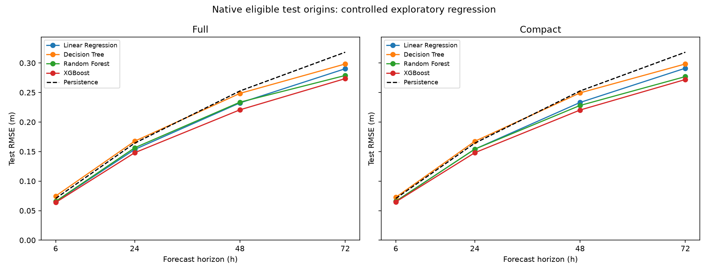
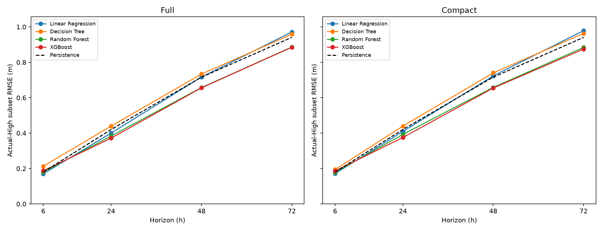

# Controlled regression experiment: forecast horizons and feature reduction

Machine Learning-Based Forecasting of High-Wave Events Along the Udupi Coast

Executed locally on 22 October 2026 using the existing Windows virtual environment. All eight configurations completed: four horizons, two feature sets, 32 saved final ML models, four unique persistence baselines and 22 PNG figures. All generated results are contained in this directory. Previous experiment documentation and results were preserved.

This is an **exploratory extension**. The historical test period informed earlier project decisions, so this experiment is not an independent confirmatory evaluation. No statistical significance or operational warning capability is established.

## Implementation and preserved components

Created five focused scripts:

- `src/controlled_pipeline.py`: frozen physical feature subset, column-only data selection and training-only smoke checks.
- `src/controlled_training.py`: identical prespecified candidate grids, horizon-aware chronological CV, validation and final refitting.
- `src/controlled_evaluation.py`: reload frozen models, predict, calculate test/category errors and generate configuration figures; no fitting.
- `src/controlled_comparison.py`: consolidated results, common-origin evaluation from saved predictions and global figures; no fitting.
- `src/controlled_verification.py`: independent NumPy scoring, saved-model reload checks, alignment, causality and preservation audits; no fitting.

The only changed pre-existing source is `src/regression_pipeline.py`: its supported-horizon guard and error message now permit 48/72 hours as well as 6/24. Its existing command-line interface remains limited to the original 6/24-hour experiments. The original source is preserved in `provenance/regression_pipeline_before.py`.

Reused without modifying: `feature_pipeline.load_source`, `feature_pipeline.make_features`, the regression split/target constructor, regression/category metrics, `regression_training.tune_model`, parameterized `regression_training.save_refits`, and parameterized `regression_evaluation.save_figure`. Existing classification scripts and outputs, regression models/results/figures, root README, requirements, `.gitignore`, `prepare_data.py` and final CSV remain unchanged. No Git commands, downloads, installs or virtual-environment changes were performed.

## Dataset and exact targets

The source `data/udupi_wave_wind_2015_2024.csv` retains 29,224 rows and 20 columns. Its timestamp grid is regular three-hourly UTC from 2015-01-01 00:00 through 2024-12-31 21:00; there are no missing/duplicate timestamps or missing/nonfinite observations. Its SHA-256 is `421199b25b1b7c475d8f09b65317f37b0aa0bf19a3385da0696e510d8a575ed8`.

Targets are continuous significant wave height in metres at exactly the future timestamp:

| Horizon | Shift | Target |
| --- | --- | --- |
| 6h | -2 | VHM0(t+6h) |
| 24h | -8 | VHM0(t+24h) |
| 48h | -16 | VHM0(t+48h) |
| 72h | -24 | VHM0(t+72h) |

No future maximum, class target or current-height target is used. Every eligible target was independently checked by selecting the original VHM0 measurement at origin plus the exact horizon. Invalid timestamp alignments: zero. The shared source loader rejects irregular grids before constructing features/targets; this experiment did not need to exclude irregular origins. Applying it to an irregular replacement dataset requires an explicitly designed exclusion policy rather than bypassing that loader.

## Fixed compact feature set

The compact set contains **18 features**, a 60.87% reduction from 46, with unchanged definitions and original relative column order. It was frozen before controlled test evaluation and applied identically to all horizons and algorithms. Selection used physical roles and unsupervised correlations on only the training origins eligible for all horizons: **20,424 origins**, 2015-01-02 00:00 UTC through 2021-12-28 21:00 UTC. No target, validation score, test score or test permutation importance was used.

| Feature | Reason retained |
| --- | --- |
| VHM0 | Current total sea-state height; legitimate persistence information. |
| VHM0_SW1 | One dominant-swell height; retained for physical partition information despite high correlation with total height. |
| VHM0_WW | Wind-sea height distinguishes local forcing from swell. |
| VTM02 | Current mean wave period; representative spectral period. |
| VTPK | Peak period complements the mean-period measure. |
| eastward_wind | Signed eastward forcing and wind orientation. |
| northward_wind | Signed northward forcing and wind orientation. |
| wind_speed | Current forcing magnitude; nonlinear magnitude is useful even with signed components. |
| VMDR_sin | Total wave direction without a discontinuity at north. |
| VMDR_cos | Paired circular encoding needed to represent wave direction. |
| VHM0_lag_6h | Representative recent sea-state history. |
| VHM0_lag_24h | Longer daily sea-state history without all intermediate lags. |
| VHM0_change_3h | Recent trend; also encodes the omitted three-hour lag. |
| VHM0_roll_mean_12h | One trailing mean summarizing recent sea-state level. |
| VHM0_roll_std_12h | Trailing variability rather than another height-level summary. |
| wind_speed_roll_mean_12h | One trailing wind-forcing memory measure. |
| month_sin | Seasonal phase representing monsoon-related annual variation. |
| month_cos | Companion seasonal encoding avoids a year-end discontinuity. |

Training-only diagnostics: standardized full design rank 39/46, compact rank 18/18. Full features include exact linear dependencies between current values, lags and changes, plus strongly overlapping rolling summaries. Rank deficiency does not invalidate ordinary least squares; the existing solver handles it. Selection was not a guarantee of predictive improvement or complete decorrelation. Dominant swell height remains highly correlated with total height, but retains a distinct physical role. Signed wind components plus speed intentionally retain both orientation and magnitude. Height change and a trailing mean also retain some lag information indirectly.

Representative absolute training correlations: current VHM0 versus its 6h rolling mean 0.9992, 3h lag 0.9969, 12h rolling mean 0.9968 and 12h rolling maximum 0.9962; wind speed versus its 6h rolling mean 0.9304. The complete correlation matrix is `training_feature_correlations.csv`. The frozen list and roles are in `compact_features.json`; all 46 keep/remove decisions are in `feature_selection_report.csv`.

The 28 removed columns and their reasons are:

| feature | physical_role_or_removal_reason |
| --- | --- |
| VHM0_SW2 | Limit swell-height representation to the dominant partition; retain total and wind-sea heights. |
| VTM01_SW1 | Use VTM02 and VTPK as representative mean/peak periods instead of many period variants and a period lag. |
| VTM01_SW2 | Use VTM02 and VTPK as representative mean/peak periods instead of many period variants and a period lag. |
| VTM01_WW | Use VTM02 and VTPK as representative mean/peak periods instead of many period variants and a period lag. |
| VTM10 | Use VTM02 and VTPK as representative mean/peak periods instead of many period variants and a period lag. |
| VMDR_SW1_sin | Replace multiple partition-specific directions with total direction and signed wind components. |
| VMDR_SW1_cos | Replace multiple partition-specific directions with total direction and signed wind components. |
| VMDR_SW2_sin | Replace multiple partition-specific directions with total direction and signed wind components. |
| VMDR_SW2_cos | Replace multiple partition-specific directions with total direction and signed wind components. |
| VMDR_WW_sin | Replace multiple partition-specific directions with total direction and signed wind components. |
| VMDR_WW_cos | Replace multiple partition-specific directions with total direction and signed wind components. |
| VHM0_lag_3h | Keep total-height 6h/24h lags; 3h height history is encoded by current height and its 3h change. |
| VHM0_lag_12h | Keep total-height 6h/24h lags; 3h height history is encoded by current height and its 3h change. |
| wind_speed_lag_3h | Keep total-height 6h/24h lags; 3h height history is encoded by current height and its 3h change. |
| wind_speed_lag_6h | Keep total-height 6h/24h lags; 3h height history is encoded by current height and its 3h change. |
| wind_speed_lag_12h | Keep total-height 6h/24h lags; 3h height history is encoded by current height and its 3h change. |
| VHM0_SW1_lag_6h | Keep total-height 6h/24h lags; 3h height history is encoded by current height and its 3h change. |
| VTM02_lag_3h | Use VTM02 and VTPK as representative mean/peak periods instead of many period variants and a period lag. |
| VHM0_change_6h | Keep one height trend; avoid multiple overlapping wave/wind changes and exact linear redundancies. |
| VHM0_change_12h | Keep one height trend; avoid multiple overlapping wave/wind changes and exact linear redundancies. |
| wind_speed_change_3h | Keep one height trend; avoid multiple overlapping wave/wind changes and exact linear redundancies. |
| wind_speed_change_6h | Keep one height trend; avoid multiple overlapping wave/wind changes and exact linear redundancies. |
| VHM0_roll_mean_6h | Keep one height mean/variability pair and one wind mean; omit overlapping means, maxima and windows. |
| VHM0_roll_mean_24h | Keep one height mean/variability pair and one wind mean; omit overlapping means, maxima and windows. |
| VHM0_roll_max_12h | Keep one height mean/variability pair and one wind mean; omit overlapping means, maxima and windows. |
| VHM0_roll_max_24h | Keep one height mean/variability pair and one wind mean; omit overlapping means, maxima and windows. |
| wind_speed_roll_mean_6h | Keep one height mean/variability pair and one wind mean; omit overlapping means, maxima and windows. |
| wind_speed_roll_max_12h | Keep one height mean/variability pair and one wind mean; omit overlapping means, maxima and windows. |

All predictors are causal: positive historical shifts, current-minus-past changes, trailing rolling windows including the current observation, current directions encoded with sine/cosine, and month derived from origin UTC. A nominal 12h rolling window contains four three-hourly observations ending at t; sample standard deviation uses ddof=1. A future-perturbation test confirmed that changing measurements after a cutoff leaves every feature through the cutoff unchanged. No future wind or wave observation enters a predictor; target columns never enter X.

## Chronology, purging and sample counts

Raw nominal partitions are fixed before exclusions: 20,456 training, 2,922 validation, 5,846 testing rows. Validation begins **2022-01-01 00:00 UTC**; testing begins **2023-01-01 06:00 UTC** for every configuration. Each feature-set pair has exactly identical origins and targets.

Training loses its first eight observations for 24h feature history, then each training/validation partition loses the final horizon_steps origins to keep targets strictly before the next nominal partition. Testing loses its final horizon_steps observations because future measurements are unavailable. Historical features at a partition start may use earlier observed history.

All date ranges below are prediction-origin timestamps in UTC, inclusive:

| horizon_hours | partition | rows | start | end | history_excluded | boundary_purged | incomplete_targets_excluded | cv_gap |
| --- | --- | --- | --- | --- | --- | --- | --- | --- |
| 6 | Training | 20446 | 2015-01-02 00:00:00+00:00 | 2021-12-31 15:00:00+00:00 | 8 | 2 | 0 | 2 |
| 6 | Validation | 2920 | 2022-01-01 00:00:00+00:00 | 2022-12-31 21:00:00+00:00 | 0 | 2 | 0 | 2 |
| 6 | Testing | 5844 | 2023-01-01 06:00:00+00:00 | 2024-12-31 15:00:00+00:00 | 0 | 0 | 2 | 2 |
| 24 | Training | 20440 | 2015-01-02 00:00:00+00:00 | 2021-12-30 21:00:00+00:00 | 8 | 8 | 0 | 8 |
| 24 | Validation | 2914 | 2022-01-01 00:00:00+00:00 | 2022-12-31 03:00:00+00:00 | 0 | 8 | 0 | 8 |
| 24 | Testing | 5838 | 2023-01-01 06:00:00+00:00 | 2024-12-30 21:00:00+00:00 | 0 | 0 | 8 | 8 |
| 48 | Training | 20432 | 2015-01-02 00:00:00+00:00 | 2021-12-29 21:00:00+00:00 | 8 | 16 | 0 | 16 |
| 48 | Validation | 2906 | 2022-01-01 00:00:00+00:00 | 2022-12-30 03:00:00+00:00 | 0 | 16 | 0 | 16 |
| 48 | Testing | 5830 | 2023-01-01 06:00:00+00:00 | 2024-12-29 21:00:00+00:00 | 0 | 0 | 16 | 16 |
| 72 | Training | 20424 | 2015-01-02 00:00:00+00:00 | 2021-12-28 21:00:00+00:00 | 8 | 24 | 0 | 24 |
| 72 | Validation | 2898 | 2022-01-01 00:00:00+00:00 | 2022-12-29 03:00:00+00:00 | 0 | 24 | 0 | 24 |
| 72 | Testing | 5822 | 2023-01-01 06:00:00+00:00 | 2024-12-28 21:00:00+00:00 | 0 | 0 | 24 | 24 |

Eligible train-plus-validation refit counts are 23,366 / 23,354 / 23,338 / 23,322 for 6 / 24 / 48 / 72 hours. Targets in refitting remain strictly before the test boundary; excluded origins are not restored. Every CV fold uses TimeSeriesSplit(n_splits=3, gap=horizon_steps), i.e. gaps 2 / 8 / 16 / 24, with a timestamp assertion that the last training target precedes the first fold-validation origin.

## Candidate grids and tuning policy

Linear Regression is unconstrained ordinary least squares inside StandardScaler + LinearRegression. Scaling is fitted independently within each CV training fold. The other algorithms use random_state=42. Forest and XGBoost use four workers; GridSearchCV is sequential. No balancing, class weights, SMOTE, artificial noise or prediction clipping is used.

These are three specific candidate tuples per tree algorithm, not Cartesian products. The grids exactly match the earlier regression experiment and remain identical across all eight configurations:

| Algorithm | Candidate 0 | Candidate 1 | Candidate 2 |
| --- | --- | --- | --- |
| Decision Tree | depth=4, split=20, leaf=20 | depth=8, split=10, leaf=10 | depth=12, split=4, leaf=4 |
| Random Forest | trees=120, depth=10, leaf=5, features=0.7 | trees=160, depth=16, leaf=2, features=1.0 | trees=220, depth=None, leaf=1, features=0.7 |
| XGBoost | trees=160, depth=2, rate=0.07, lambda=5 | trees=220, depth=4, rate=0.05, lambda=8 | trees=300, depth=6, rate=0.05, lambda=5 |

XGBoost uses reg:squarederror, hist trees, subsample=0.8 and colsample_bytree=0.8, preserving previous defaults. Full estimator settings and package versions are saved in each model_metadata.json. Candidate grids are frozen in `candidate_grids.json`.

Selection minimizes mean training-only three-fold RMSE, with lower sample standard deviation (ddof=1), then earlier candidate index breaking exact ties. Validation is diagnostic only: it does not change the subset, grids, algorithm roster or selected settings. Each selected estimator is fitted on training for validation, then a fresh clone is refitted on eligible training+validation. All eight configurations were saved before any controlled test predictions were made. No model was refitted after test inspection.

There are 240 CV fold fits, 32 training-only validation fits and 32 final refits. The separately executed training-only smoke test made 12 small depth-3 decision-tree fits and checked in-memory serialization before full training. Exactly 32 final model artifacts are retained.

Selected settings, CV RMSE (mean/sample standard deviation) and pre-refit validation RMSE for all 32 models:

| horizon_hours | feature_set | model | selected_parameters | cv_rmse | cv_rmse_std | validation_rmse |
| --- | --- | --- | --- | --- | --- | --- |
| 6 | compact | Decision Tree | {"max_depth": 8, "min_samples_leaf": 10, "min_samples_split": 10} | 0.096410 | 0.004237 | 0.077235 |
| 6 | compact | Linear Regression | {} | 0.084713 | 0.007855 | 0.071125 |
| 6 | compact | Random Forest | {"max_depth": 10, "max_features": 0.7, "min_samples_leaf": 5, "n_estimators": 120} | 0.086936 | 0.006204 | 0.070801 |
| 6 | compact | XGBoost | {"learning_rate": 0.05, "max_depth": 4, "n_estimators": 220, "reg_lambda": 8} | 0.087599 | 0.010290 | 0.068914 |
| 6 | full | Decision Tree | {"max_depth": 8, "min_samples_leaf": 10, "min_samples_split": 10} | 0.098287 | 0.002266 | 0.080696 |
| 6 | full | Linear Regression | {} | 0.084408 | 0.007855 | 0.071279 |
| 6 | full | Random Forest | {"max_depth": 10, "max_features": 0.7, "min_samples_leaf": 5, "n_estimators": 120} | 0.086898 | 0.006085 | 0.070978 |
| 6 | full | XGBoost | {"learning_rate": 0.05, "max_depth": 4, "n_estimators": 220, "reg_lambda": 8} | 0.085607 | 0.009286 | 0.068117 |
| 24 | compact | Decision Tree | {"max_depth": 4, "min_samples_leaf": 20, "min_samples_split": 20} | 0.209329 | 0.017481 | 0.167989 |
| 24 | compact | Linear Regression | {} | 0.194210 | 0.019154 | 0.152458 |
| 24 | compact | Random Forest | {"max_depth": 10, "max_features": 0.7, "min_samples_leaf": 5, "n_estimators": 120} | 0.193729 | 0.015982 | 0.151897 |
| 24 | compact | XGBoost | {"learning_rate": 0.05, "max_depth": 4, "n_estimators": 220, "reg_lambda": 8} | 0.188395 | 0.013575 | 0.150867 |
| 24 | full | Decision Tree | {"max_depth": 4, "min_samples_leaf": 20, "min_samples_split": 20} | 0.209965 | 0.017564 | 0.167309 |
| 24 | full | Linear Regression | {} | 0.193453 | 0.020018 | 0.154023 |
| 24 | full | Random Forest | {"max_depth": 10, "max_features": 0.7, "min_samples_leaf": 5, "n_estimators": 120} | 0.197484 | 0.014697 | 0.155312 |
| 24 | full | XGBoost | {"learning_rate": 0.05, "max_depth": 4, "n_estimators": 220, "reg_lambda": 8} | 0.189339 | 0.014357 | 0.150871 |
| 48 | compact | Decision Tree | {"max_depth": 4, "min_samples_leaf": 20, "min_samples_split": 20} | 0.301012 | 0.036952 | 0.260373 |
| 48 | compact | Linear Regression | {} | 0.288759 | 0.037269 | 0.228513 |
| 48 | compact | Random Forest | {"max_depth": 10, "max_features": 0.7, "min_samples_leaf": 5, "n_estimators": 120} | 0.286102 | 0.031005 | 0.232211 |
| 48 | compact | XGBoost | {"learning_rate": 0.05, "max_depth": 4, "n_estimators": 220, "reg_lambda": 8} | 0.277925 | 0.031888 | 0.227628 |
| 48 | full | Decision Tree | {"max_depth": 4, "min_samples_leaf": 20, "min_samples_split": 20} | 0.302878 | 0.034752 | 0.258250 |
| 48 | full | Linear Regression | {} | 0.286866 | 0.038364 | 0.231589 |
| 48 | full | Random Forest | {"max_depth": 10, "max_features": 0.7, "min_samples_leaf": 5, "n_estimators": 120} | 0.291033 | 0.028402 | 0.234384 |
| 48 | full | XGBoost | {"learning_rate": 0.05, "max_depth": 4, "n_estimators": 220, "reg_lambda": 8} | 0.280337 | 0.032077 | 0.224931 |
| 72 | compact | Decision Tree | {"max_depth": 4, "min_samples_leaf": 20, "min_samples_split": 20} | 0.372177 | 0.052018 | 0.307757 |
| 72 | compact | Linear Regression | {} | 0.349357 | 0.046626 | 0.281124 |
| 72 | compact | Random Forest | {"max_depth": 10, "max_features": 0.7, "min_samples_leaf": 5, "n_estimators": 120} | 0.348847 | 0.044086 | 0.289038 |
| 72 | compact | XGBoost | {"learning_rate": 0.07, "max_depth": 2, "n_estimators": 160, "reg_lambda": 5} | 0.337275 | 0.047172 | 0.280226 |
| 72 | full | Decision Tree | {"max_depth": 4, "min_samples_leaf": 20, "min_samples_split": 20} | 0.377686 | 0.042301 | 0.306441 |
| 72 | full | Linear Regression | {} | 0.347064 | 0.048254 | 0.283008 |
| 72 | full | Random Forest | {"max_depth": 10, "max_features": 0.7, "min_samples_leaf": 5, "n_estimators": 120} | 0.357941 | 0.042315 | 0.286165 |
| 72 | full | XGBoost | {"learning_rate": 0.07, "max_depth": 2, "n_estimators": 160, "reg_lambda": 5} | 0.339067 | 0.045593 | 0.279602 |

Complete candidate parameters, per-fold RMSE/MAE, means, sample standard deviations, selection flags and fold dates are retained in each configuration's `tuning_results.csv`.

## Primary native-origin test RMSE (metres)

Rows use each horizon's native eligible test origins; full and compact are paired within a horizon. Persistence predicts current VHM0 at every origin and uses one unique baseline file per horizon, reused for both feature sets.

| horizon_hours | feature_set | Persistence | Linear Regression | Decision Tree | Random Forest | XGBoost |
| --- | --- | --- | --- | --- | --- | --- |
| 6 | compact | 0.070679 | 0.065885 | 0.072639 | 0.065874 | 0.064838 |
| 6 | full | 0.070679 | 0.065403 | 0.074729 | 0.065713 | 0.063851 |
| 24 | compact | 0.164192 | 0.154105 | 0.167400 | 0.154109 | 0.148063 |
| 24 | full | 0.164192 | 0.153510 | 0.167565 | 0.156393 | 0.148001 |
| 48 | compact | 0.252589 | 0.233158 | 0.249369 | 0.228081 | 0.220335 |
| 48 | full | 0.252589 | 0.232428 | 0.248512 | 0.233634 | 0.220694 |
| 72 | compact | 0.318219 | 0.291165 | 0.298328 | 0.276940 | 0.272015 |
| 72 | full | 0.318219 | 0.290248 | 0.298269 | 0.278811 | 0.273503 |

The comparison does not make different forecast horizons identical prediction tasks: future timestamps differ and the native final-origin counts differ slightly.

## MAE, R-squared, baseline improvement and actual-High errors

RMSE improvement is 100 * (persistence_rmse - model_rmse) / persistence_rmse; positive values indicate lower error than persistence, negative values worse. All errors are in metres; R-squared is unitless. High subsets are conditioned on actual future VHM0 > 3.0 m, not predicted categories.

| horizon_hours | feature_set | model | test_mae | test_rmse | test_r2 | rmse_improvement_pct | high_wave_mae | high_wave_rmse |
| --- | --- | --- | --- | --- | --- | --- | --- | --- |
| 6 | compact | Decision Tree | 0.048910 | 0.072639 | 0.989494 | -2.773341 | 0.140817 | 0.194008 |
| 6 | compact | Linear Regression | 0.045017 | 0.065885 | 0.991356 | 6.781785 | 0.126102 | 0.171494 |
| 6 | compact | Random Forest | 0.044447 | 0.065874 | 0.991359 | 6.798371 | 0.129030 | 0.178132 |
| 6 | compact | XGBoost | 0.043060 | 0.064838 | 0.991629 | 8.263673 | 0.133457 | 0.186568 |
| 6 | full | Decision Tree | 0.049663 | 0.074729 | 0.988880 | -5.729949 | 0.157860 | 0.213324 |
| 6 | full | Linear Regression | 0.044513 | 0.065403 | 0.991483 | 7.465001 | 0.125534 | 0.170302 |
| 6 | full | Random Forest | 0.044158 | 0.065713 | 0.991401 | 7.025257 | 0.132380 | 0.180011 |
| 6 | full | XGBoost | 0.042027 | 0.063851 | 0.991882 | 9.660139 | 0.133059 | 0.187407 |
| 24 | compact | Decision Tree | 0.114428 | 0.167400 | 0.944253 | -1.953771 | 0.364520 | 0.439751 |
| 24 | compact | Linear Regression | 0.105821 | 0.154105 | 0.952757 | 6.143499 | 0.331179 | 0.409854 |
| 24 | compact | Random Forest | 0.103914 | 0.154109 | 0.952754 | 6.140619 | 0.309553 | 0.393044 |
| 24 | compact | XGBoost | 0.101217 | 0.148063 | 0.956388 | 9.823197 | 0.298076 | 0.375493 |
| 24 | full | Decision Tree | 0.114885 | 0.167565 | 0.944143 | -2.054316 | 0.364520 | 0.439751 |
| 24 | full | Linear Regression | 0.105479 | 0.153510 | 0.953120 | 6.505418 | 0.323475 | 0.400630 |
| 24 | full | Random Forest | 0.105438 | 0.156393 | 0.951343 | 4.749946 | 0.305252 | 0.383705 |
| 24 | full | XGBoost | 0.100743 | 0.148001 | 0.956425 | 9.860785 | 0.295589 | 0.371637 |
| 48 | compact | Decision Tree | 0.167939 | 0.249369 | 0.876423 | 1.274774 | 0.643926 | 0.740138 |
| 48 | compact | Linear Regression | 0.161837 | 0.233158 | 0.891967 | 7.692387 | 0.597163 | 0.723293 |
| 48 | compact | Random Forest | 0.154445 | 0.228081 | 0.896622 | 9.702699 | 0.524427 | 0.658110 |
| 48 | compact | XGBoost | 0.150518 | 0.220335 | 0.903523 | 12.769062 | 0.511974 | 0.654363 |
| 48 | full | Decision Tree | 0.167411 | 0.248512 | 0.877271 | 1.613931 | 0.632569 | 0.733552 |
| 48 | full | Linear Regression | 0.160727 | 0.232428 | 0.892643 | 7.981711 | 0.594696 | 0.716457 |
| 48 | full | Random Forest | 0.157797 | 0.233634 | 0.891526 | 7.503998 | 0.527932 | 0.657231 |
| 48 | full | XGBoost | 0.151264 | 0.220694 | 0.903209 | 12.626890 | 0.520641 | 0.655634 |
| 72 | compact | Decision Tree | 0.203614 | 0.298328 | 0.823293 | 6.250772 | 0.882598 | 0.963269 |
| 72 | compact | Linear Regression | 0.201933 | 0.291165 | 0.831676 | 8.501610 | 0.849555 | 0.978623 |
| 72 | compact | Random Forest | 0.188996 | 0.276940 | 0.847722 | 12.971921 | 0.766632 | 0.883624 |
| 72 | compact | XGBoost | 0.187745 | 0.272015 | 0.853090 | 14.519604 | 0.760432 | 0.874604 |
| 72 | full | Decision Tree | 0.203832 | 0.298269 | 0.823363 | 6.269312 | 0.874044 | 0.958555 |
| 72 | full | Linear Regression | 0.200935 | 0.290248 | 0.832735 | 8.789953 | 0.851160 | 0.970964 |
| 72 | full | Random Forest | 0.189196 | 0.278811 | 0.845657 | 12.384004 | 0.775943 | 0.886149 |
| 72 | full | XGBoost | 0.188057 | 0.273503 | 0.851478 | 14.052018 | 0.780621 | 0.884929 |

Baseline MAE, R-squared and High-wave RMSE:

| horizon_hours | mae | rmse | r2 | high_rmse |
| --- | --- | --- | --- | --- |
| 6 | 0.048299 | 0.070679 | 0.990053 | 0.180493 |
| 24 | 0.109274 | 0.164192 | 0.946369 | 0.420324 |
| 48 | 0.169815 | 0.252589 | 0.873211 | 0.716157 |
| 72 | 0.210436 | 0.318219 | 0.798943 | 0.940607 |

Research diagnostic categories are Normal < 2.5 m, Elevated 2.5-3.0 m inclusive, High > 3.0 m. These are not official marine warnings. Category counts are identical across feature sets and algorithms:

| Horizon | Normal | Elevated | High |
| --- | --- | --- | --- |
| 6 | 5464 | 264 | 116 |
| 24 | 5458 | 264 | 116 |
| 48 | 5450 | 264 | 116 |
| 72 | 5442 | 264 | 116 |

High-wave signed bias and underprediction details for all models follow. Underprediction frequency is a fraction of actual-High observations with prediction strictly below actual height. Mean underprediction magnitude averages actual minus predicted over only those underestimated cases, not over all High cases. Category helpers return NaN safely for undefined empty subsets. All test subsets here are populated.

| horizon_hours | feature_set | model | high_wave_test_count | high_wave_bias | high_wave_underprediction_frequency | high_wave_mean_underprediction |
| --- | --- | --- | --- | --- | --- | --- |
| 6 | compact | Decision Tree | 116 | -0.044809 | 0.577586 | 0.160691 |
| 6 | compact | Linear Regression | 116 | -0.033108 | 0.525862 | 0.151380 |
| 6 | compact | Random Forest | 116 | -0.039029 | 0.560345 | 0.149961 |
| 6 | compact | XGBoost | 116 | -0.025188 | 0.560345 | 0.141560 |
| 6 | full | Decision Tree | 116 | -0.035443 | 0.551724 | 0.175181 |
| 6 | full | Linear Regression | 116 | -0.032100 | 0.525862 | 0.149882 |
| 6 | full | Random Forest | 116 | -0.043687 | 0.568966 | 0.154726 |
| 6 | full | XGBoost | 116 | -0.011907 | 0.508621 | 0.142508 |
| 24 | compact | Decision Tree | 116 | -0.258888 | 0.750000 | 0.415605 |
| 24 | compact | Linear Regression | 116 | -0.205868 | 0.715517 | 0.375286 |
| 24 | compact | Random Forest | 116 | -0.179175 | 0.689655 | 0.354328 |
| 24 | compact | XGBoost | 116 | -0.152047 | 0.637931 | 0.352799 |
| 24 | full | Decision Tree | 116 | -0.258888 | 0.750000 | 0.415605 |
| 24 | full | Linear Regression | 116 | -0.204701 | 0.724138 | 0.364693 |
| 24 | full | Random Forest | 116 | -0.200326 | 0.732759 | 0.344982 |
| 24 | full | XGBoost | 116 | -0.189407 | 0.689655 | 0.351622 |
| 48 | compact | Decision Tree | 116 | -0.643926 | 1.000000 | 0.643926 |
| 48 | compact | Linear Regression | 116 | -0.523995 | 0.784483 | 0.714584 |
| 48 | compact | Random Forest | 116 | -0.455590 | 0.775862 | 0.631567 |
| 48 | compact | XGBoost | 116 | -0.451172 | 0.810345 | 0.594282 |
| 48 | full | Decision Tree | 116 | -0.632569 | 1.000000 | 0.632569 |
| 48 | full | Linear Regression | 116 | -0.526861 | 0.827586 | 0.677607 |
| 48 | full | Random Forest | 116 | -0.495379 | 0.844828 | 0.605633 |
| 48 | full | XGBoost | 116 | -0.489869 | 0.879310 | 0.574604 |
| 72 | compact | Decision Tree | 116 | -0.882598 | 1.000000 | 0.882598 |
| 72 | compact | Linear Regression | 116 | -0.833343 | 0.948276 | 0.887346 |
| 72 | compact | Random Forest | 116 | -0.760223 | 0.965517 | 0.790693 |
| 72 | compact | XGBoost | 116 | -0.760432 | 1.000000 | 0.760432 |
| 72 | full | Decision Tree | 116 | -0.874044 | 1.000000 | 0.874044 |
| 72 | full | Linear Regression | 116 | -0.830193 | 0.939655 | 0.894665 |
| 72 | full | Random Forest | 116 | -0.775240 | 0.982759 | 0.789198 |
| 72 | full | XGBoost | 116 | -0.780621 | 1.000000 | 0.780621 |

Both 72h XGBoost models underestimate all 116 actual-High cases: compact mean shortfall 0.760432 m and full mean shortfall 0.780621 m. The lowest overall RMSE therefore does not establish adequate extreme-event forecasting. No negative test predictions occurred and no predictions were clipped. All three category MAE/RMSE, bias, counts and underprediction measures for all five methods are in each configuration's `category_errors.csv`.

## Full versus compact

Difference = compact RMSE minus full RMSE. Positive means feature reduction worsened RMSE; negative means it improved RMSE. Percentage uses full RMSE as denominator.

| horizon_hours | model | test_rmse_full | test_rmse_compact | rmse_change_compact_minus_full | rmse_change_percent_of_full |
| --- | --- | --- | --- | --- | --- |
| 6 | Decision Tree | 0.074729 | 0.072639 | -0.002090 | -2.796377 |
| 6 | Linear Regression | 0.065403 | 0.065885 | 0.000483 | 0.738333 |
| 6 | Random Forest | 0.065713 | 0.065874 | 0.000160 | 0.244030 |
| 6 | XGBoost | 0.063851 | 0.064838 | 0.000987 | 1.545791 |
| 24 | Decision Tree | 0.167565 | 0.167400 | -0.000165 | -0.098521 |
| 24 | Linear Regression | 0.153510 | 0.154105 | 0.000594 | 0.387102 |
| 24 | Random Forest | 0.156393 | 0.154109 | -0.002283 | -1.460024 |
| 24 | XGBoost | 0.148001 | 0.148063 | 0.000062 | 0.041700 |
| 48 | Decision Tree | 0.248512 | 0.249369 | 0.000857 | 0.344721 |
| 48 | Linear Regression | 0.232428 | 0.233158 | 0.000731 | 0.314419 |
| 48 | Random Forest | 0.233634 | 0.228081 | -0.005554 | -2.377077 |
| 48 | XGBoost | 0.220694 | 0.220335 | -0.000359 | -0.162719 |
| 72 | Decision Tree | 0.298269 | 0.298328 | 0.000059 | 0.019780 |
| 72 | Linear Regression | 0.290248 | 0.291165 | 0.000918 | 0.316131 |
| 72 | Random Forest | 0.278811 | 0.276940 | -0.001871 | -0.671016 |
| 72 | XGBoost | 0.273503 | 0.272015 | -0.001488 | -0.544034 |

## XGBoost versus Linear Regression

Difference = Linear Regression RMSE minus XGBoost RMSE. Positive means XGBoost improved RMSE; percentage uses Linear Regression RMSE as denominator.

| horizon_hours | feature_set | test_rmse_linear | test_rmse_xgb | rmse_reduction_linear_minus_xgb | xgb_improvement_percent_over_linear |
| --- | --- | --- | --- | --- | --- |
| 6 | compact | 0.065885 | 0.064838 | 0.001047 | 1.589698 |
| 6 | full | 0.065403 | 0.063851 | 0.001551 | 2.372224 |
| 24 | compact | 0.154105 | 0.148063 | 0.006042 | 3.920558 |
| 24 | full | 0.153510 | 0.148001 | 0.005509 | 3.588835 |
| 48 | compact | 0.233158 | 0.220335 | 0.012823 | 5.499736 |
| 48 | full | 0.232428 | 0.220694 | 0.011733 | 5.048104 |
| 72 | compact | 0.291165 | 0.272015 | 0.019150 | 6.577158 |
| 72 | full | 0.290248 | 0.273503 | 0.016745 | 5.769172 |

## Rankings and persistence

The four ML algorithms are ranked by primary test RMSE in `algorithm_rankings.csv`; persistence is explicitly a separate unranked baseline. Detailed pairwise outcomes are in `algorithm_comparisons.csv`.

| horizon_hours | feature_set | method | ml_rank | rmse | method_type |
| --- | --- | --- | --- | --- | --- |
| 6 | full | XGBoost | 1.000000 | 0.063851 | learned |
| 6 | full | Linear Regression | 2.000000 | 0.065403 | learned |
| 6 | full | Random Forest | 3.000000 | 0.065713 | learned |
| 6 | full | Decision Tree | 4.000000 | 0.074729 | learned |
| 6 | full | Persistence | nan | 0.070679 | baseline |
| 6 | compact | XGBoost | 1.000000 | 0.064838 | learned |
| 6 | compact | Random Forest | 2.000000 | 0.065874 | learned |
| 6 | compact | Linear Regression | 3.000000 | 0.065885 | learned |
| 6 | compact | Decision Tree | 4.000000 | 0.072639 | learned |
| 6 | compact | Persistence | nan | 0.070679 | baseline |
| 24 | full | XGBoost | 1.000000 | 0.148001 | learned |
| 24 | full | Linear Regression | 2.000000 | 0.153510 | learned |
| 24 | full | Random Forest | 3.000000 | 0.156393 | learned |
| 24 | full | Decision Tree | 4.000000 | 0.167565 | learned |
| 24 | full | Persistence | nan | 0.164192 | baseline |
| 24 | compact | XGBoost | 1.000000 | 0.148063 | learned |
| 24 | compact | Linear Regression | 2.000000 | 0.154105 | learned |
| 24 | compact | Random Forest | 3.000000 | 0.154109 | learned |
| 24 | compact | Decision Tree | 4.000000 | 0.167400 | learned |
| 24 | compact | Persistence | nan | 0.164192 | baseline |
| 48 | full | XGBoost | 1.000000 | 0.220694 | learned |
| 48 | full | Linear Regression | 2.000000 | 0.232428 | learned |
| 48 | full | Random Forest | 3.000000 | 0.233634 | learned |
| 48 | full | Decision Tree | 4.000000 | 0.248512 | learned |
| 48 | full | Persistence | nan | 0.252589 | baseline |
| 48 | compact | XGBoost | 1.000000 | 0.220335 | learned |
| 48 | compact | Random Forest | 2.000000 | 0.228081 | learned |
| 48 | compact | Linear Regression | 3.000000 | 0.233158 | learned |
| 48 | compact | Decision Tree | 4.000000 | 0.249369 | learned |
| 48 | compact | Persistence | nan | 0.252589 | baseline |
| 72 | full | XGBoost | 1.000000 | 0.273503 | learned |
| 72 | full | Random Forest | 2.000000 | 0.278811 | learned |
| 72 | full | Linear Regression | 3.000000 | 0.290248 | learned |
| 72 | full | Decision Tree | 4.000000 | 0.298269 | learned |
| 72 | full | Persistence | nan | 0.318219 | baseline |
| 72 | compact | XGBoost | 1.000000 | 0.272015 | learned |
| 72 | compact | Random Forest | 2.000000 | 0.276940 | learned |
| 72 | compact | Linear Regression | 3.000000 | 0.291165 | learned |
| 72 | compact | Decision Tree | 4.000000 | 0.298328 | learned |
| 72 | compact | Persistence | nan | 0.318219 | baseline |

## Supplementary common-origin comparison

All configurations share 5,822 eligible test origins, 2023-01-01 06:00 UTC through 2024-12-28 21:00 UTC. These scores reuse saved predictions from already-fitted models; there was no retraining or new selection. Targets remain horizon-specific even at identical origins.

| horizon_hours | feature_set | Persistence | Linear Regression | Decision Tree | Random Forest | XGBoost |
| --- | --- | --- | --- | --- | --- | --- |
| 6 | compact | 0.070790 | 0.065980 | 0.072753 | 0.065974 | 0.064931 |
| 6 | full | 0.070790 | 0.065500 | 0.074845 | 0.065816 | 0.063949 |
| 24 | compact | 0.164401 | 0.154305 | 0.167617 | 0.154307 | 0.148252 |
| 24 | full | 0.164401 | 0.153710 | 0.167783 | 0.156595 | 0.148192 |
| 48 | compact | 0.252746 | 0.233311 | 0.249522 | 0.228235 | 0.220482 |
| 48 | full | 0.252746 | 0.232582 | 0.248665 | 0.233790 | 0.220842 |
| 72 | compact | 0.318219 | 0.291165 | 0.298328 | 0.276940 | 0.272015 |
| 72 | full | 0.318219 | 0.290248 | 0.298269 | 0.278811 | 0.273503 |

All common-origin metrics are saved in `common_origin_results.csv`. Rankings and the descriptive conclusions remain unchanged on this subset.

## Interpretation of the observed experiment

1. **Horizon:** Every algorithm and persistence has increasing RMSE from 6 to 72 hours, in both feature sets and on the common-origin subset. Higher error is consistent with a harder longer-horizon task, but this is one coastal series and one historical test period.
2. **XGBoost versus linear:** XGBoost has lower overall RMSE in all eight configurations. Its relative advantage increases from 2.37% to 5.77% with full inputs and 1.59% to 6.58% with compact inputs. Absolute gains grow from roughly 0.001-0.002 m at 6h to 0.017-0.019 m at 72h. These are descriptive differences, not significance claims.
3. **Feature reduction:** The same 18 features preserve most overall performance. XGBoost compact RMSE is 1.55% worse at 6h and 0.04% worse at 24h, then 0.16% better at 48h and 0.54% better at 72h. The compact set is a credible simpler candidate for further evaluation, not a universally superior selected deployment model.
4. **Different model response:** Linear Regression gets slightly worse at all horizons (0.31-0.74%). Random Forest is 0.24% worse at 6h but improves by 1.46%, 2.38% and 0.67% at 24/48/72h. Decision Tree improves at 6/24h but worsens at 48/72h. Reduction affects model families differently and does not guarantee improvement.
5. **Forest versus single tree:** Random Forest outperforms Decision Tree in all eight comparisons. Linear Regression also outperforms Decision Tree in all eight. Complexity alone does not determine the full ranking: Linear Regression beats Random Forest for full 6/24/48h and compact 24h (the last difference is only about 0.000005 m).
6. **XGBoost versus forest:** XGBoost outperforms Random Forest overall in every configuration. At 72h its full-set advantage over forest is only about 0.0053 m; High-wave differences between the ensembles can also be small.
7. **Persistence:** Linear Regression, Random Forest and XGBoost beat persistence at every horizon/feature set. Decision Tree loses to persistence at 6/24h, then beats it at 48/72h. XGBoost's relative baseline improvement grows from 8.26-9.66% at 6h to 14.05-14.52% at 72h.
8. **Actual High conditions:** Linear Regression has the lowest High-wave RMSE at 6h (full 0.170302 m; compact 0.171494 m). XGBoost has the lowest at 24/48/72h, but substantial long-horizon underprediction remains. Overall-error ranking must be considered alongside this failure mode.
9. **Practical importance:** Many feature-set differences are millimetres, with the largest observed absolute change roughly 0.0056 m (Random Forest at 48h). The full-set XGBoost gain over linear grows to roughly 0.017 m at 72h, while actual-High RMSE is still around 0.88 m. An application-specific error tolerance, event-level evaluation and uncertainty analysis are needed to decide practical usefulness. No statistically significant improvement, official warning readiness or guaranteed future performance is claimed.

For the undergraduate comparison, retain all four model families plus persistence. XGBoost is the strongest overall-error research candidate; compact XGBoost offers similar performance with fewer inputs. Linear Regression remains a useful interpretable reference and leads the 6h High-wave subset. These are observations to guide future research, not a test-tuned new production selection.

## Figures

All 22 PNG files are below `figures/`: six global comparisons plus two for each of eight configurations.

- `rmse_vs_horizon.png`: all algorithms and persistence, separate full/compact panels.
- `full_vs_compact_rmse.png`: paired feature-set errors at each horizon.
- `xgboost_vs_linear.png`: both algorithms across all horizons and feature sets.
- `persistence_vs_ml.png`: percentage RMSE improvement relative to persistence (zero reference).
- `high_wave_rmse_vs_horizon.png`: actual-High subset errors, with persistence.
- `feature_count_vs_rmse.png`: 18 versus 46 inputs by algorithm and horizon.
- `<horizon>_hour/<full|compact>/time_series.png`: entire test period plus July 1-14 of the first test year. The fixed calendar rule was encoded before scoring; it was not chosen to favor a model. X-axis is forecast-origin UTC; actual is the future target at that origin.
- `<horizon>_hour/<full|compact>/residual_distributions.png`: all test residuals, defined as prediction minus actual, with shared histogram bins within each panel.





## Output structure

```text
experiments/controlled_regression/
|-- README.md
|-- compact_features.json
|-- feature_selection_report.csv
|-- training_feature_correlations.csv
|-- candidate_grids.json
|-- master_results.csv                    # 32 ML rows; CV, validation, test, High errors
|-- partition_summary.csv                 # 12 native partition rows
|-- full_vs_compact.csv                   # 16 paired comparisons
|-- xgboost_vs_linear.csv                 # 8 paired comparisons
|-- algorithm_rankings.csv                # 32 ML ranks plus 8 separate baseline rows
|-- algorithm_comparisons.csv             # 8 descriptive outcome rows
|-- common_origin_results.csv            # 40 method/configuration rows
|-- {6,24,48,72}_hour/
|   |-- persistence_results.csv           # one unique native baseline per horizon
|   |-- {full,compact}/
|       |-- models/                       # four independent .joblib files
|       |-- model_metadata.json
|       |-- tuning_results.csv            # 30 candidate/fold rows
|       |-- validation_results.csv        # five methods
|       |-- test_results.csv              # five methods, RMSE sorted
|       |-- test_predictions.csv          # origins, targets, five predictions
|       |-- category_errors.csv           # 15 method/category rows
|       |-- validation_test_comparison.csv
|-- figures/                             # all 22 figures
|-- provenance/
    |-- previous_files_sha256.json
    |-- previous_dataset_fingerprints.json
    |-- regression_pipeline_before.py
    |-- smoke_test.json
    |-- final_verification.json
```

## Execution and reproducibility

The commands actually used from the project root were:

```powershell
.\.venv\Scripts\python.exe -B -u src/controlled_pipeline.py --select-features --smoke
.\.venv\Scripts\python.exe -B -u src/controlled_training.py --all
$env:MPLBACKEND = 'Agg'
.\.venv\Scripts\python.exe -B -u src/controlled_evaluation.py
.\.venv\Scripts\python.exe -B -u src/controlled_comparison.py
.\.venv\Scripts\python.exe -B -u src/controlled_verification.py
```

The training command refuses to overwrite an existing completed configuration. It is recorded to explain the executed workflow, not as an instruction to overwrite or retune these saved experiments. A future training rerun should be a separately authorized experiment. Evaluation, comparison and verification perform no fitting. Saved models, feature order, source checksum, frozen feature checksum and package versions are checked before inference. Agg was used for noninteractive figure generation; the reused save helper emitted display warnings after saving, which do not affect the PNG files. No new dependencies were needed.

## Verification and limitations

Independent checks passed for all 32 saved model reloads and saved predictions; all test and category metrics were independently recalculated in NumPy. Common-origin metrics, consolidated table values, percentage/difference signs and CV mean/std/selected-candidate arithmetic were also verified. Full/compact origin-target identity, exact horizon offsets, strict boundary/CV separation and future-perturbation causality passed. A SHA-256 manifest verified 132 pre-existing files byte-for-byte; the remaining pre-existing source has exactly the permitted two-line guard/message change. Original 6h/24h X/y fingerprints are identical and their full-feature test MAE/RMSE/R-squared/High errors are reproduced to numeric tolerance. The source CSV and `prepare_data.py` are unchanged.

Verification scope for validation: persistence metrics were independently recalculated, and all ML validation metrics agree with the frozen pre-refit metadata. Training-only validation predictions were not retained, so their raw-prediction metrics cannot be independently reconstructed without fitting again. No post-test fitting was performed. Full pre-refit validation metrics and CV fold scores are still preserved.

Scientific limitations include offshore model/reanalysis representations rather than direct beach measurements, one reference location, strongly dependent three-hourly samples, only 116 High target records per native test horizon, no event-block uncertainty analysis, a small fixed tuning grid and prior test-period reuse. Correlations used for physical subset design came from the designated training partition rather than nested unsupervised selection inside each CV fold; CV is a tuning diagnostic conditional on that frozen subset. Current reanalysis measurements are treated as available at origin t, but actual operational latency and forecast-weather inputs have not been modeled. No seven-day forecast was implemented. Results do not establish official warning thresholds or operational coastal forecasting capability.
